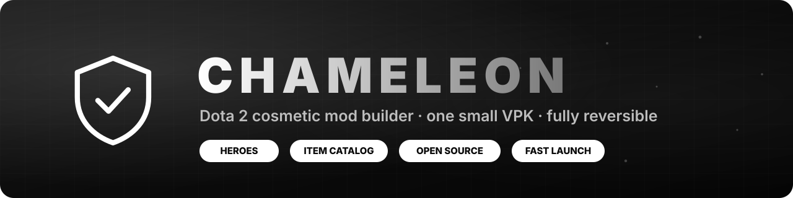
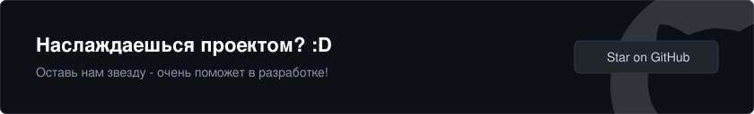
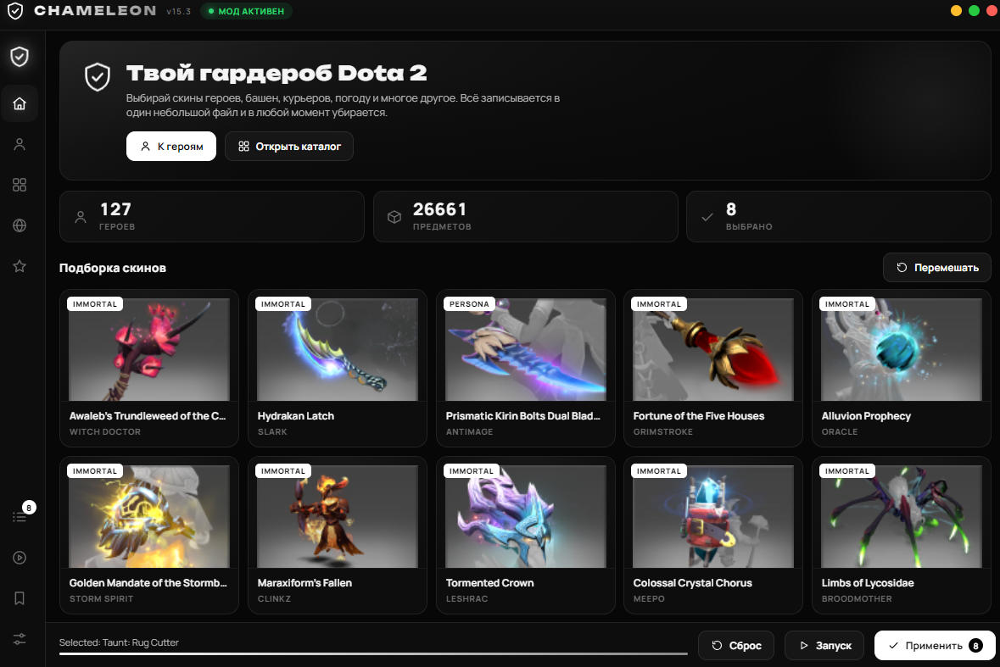

# Chameleon
> Dota2 VPK Skinchanger with auto parse items

<div align="center">



<br><br>

<p align="center">
  <a href="https://github.com/therample/dota2-chameleon">
    
  </a>
</p>



> Ui preview

<br><br>

[](https://rample.pythonanywhere.com)
[](CHANGELOG.md)
[](https://www.python.org/)
[](#установка)
[](LICENSE)

</div>

#### **Chameleon** — это быстрый, локальный скинченджер для Dota 2 с открытым исходным кодом. Он позволяет кастомизировать внешний вид героев, элементы окружения картах, интерфейс и звуковое сопровождение игры без покупки предметов.

> [!IMPORTANT]
> Программа является сторонним клиентским модом для изменения косметических элементов и никак не связана с Valve Corporation. Все модификации видны **только вам** на вашем экране. Вы используете ПО по принципу «как есть» на свой страх и риск — финальное решение о допустимости подобных модификаций всегда остается за разработчиками игры.

   

## Что умеет Chameleon

* **Кастомизация героев:** Любой предмет для любого слота, аркана и персоны, насмешки и самоцвет арканы (например, Призматик у Terrorblade). Внутри героя есть поиск, сортировка и счётчик изменений.
* **Каталог с предметами:** Башни, крипы, Рошан, древние, торменторы, варды, курьеры, погода, ландшафт, эффекты, скины HUD, курсоры, загрузочные экраны, музыка, дикторы и многое другое. Поиск работает в каждом разделе.
* **Избранное:** Нажми звёздочку на понравившемся предмете — и потом найдёшь его в одном месте.
* **Изменение мира:** Своя река и **собственная картинка или видео** на фоне главного меню.
* **Шрифты:** Шрифт из самой игры или свой файл `.ttf` / `.otf`.
* **Пресеты запуска:** Запускай Dota 2 с нужными параметрами — без заставки, в окне, с консолью.
* **Пресеты с скинами:** Сохрани весь свой выбор под именем и загрузи его позже одним нажатием.
* **Два языка:** Интерфейс программы на русском и английском.

> [!TIP]
> Поиск элементов в экспериментальных категориях (шейдеры, Рошан, торменторы) работает по ключевым словам. Если в вашей версии игры они отображаются некорректно, запустите скрипт диагностики: `python -m chameleon.diagnose "<путь_к_Dota>" --categories` и отправьте строки с тегом `UNMAPPED` в [Issues проекта](../../issues/new?template=category_rule.yml).

   

## Быстрый старт

### Требования
* Python 3.10 или выше
* ОС Windows (с установленным игровым клиентом Steam)

### Установка и запуск
```bash
# Клонируйте репозиторий
git clone https://github.com/therample/dota2-chameleon.git
cd dota2-chameleon

# Установите необходимые зависимости
pip install -r requirements.txt

# Запустите скинченджер
python run.py
```

*Рекомендуется (опционально):* установите бесплатную утилиту [ffmpeg](https://ffmpeg.org/download.html). Она необходима Chameleon для автоматической подготовки и конвертации ваших изображений или видео для фона меню.
### Порядок работы:
1.  **Выбор модов:** При первом запуске Chameleon автоматически определит пути к Steam и Dota 2 (если этого не произошло, укажите их вручную во вкладке **«Настройки»**). Сформируйте свою сборку в разделах **«Герои»** или **«Каталог»**. Клик по карточке добавляет предмет в текущую сборку, повторный клик — убирает его. Всё выбранное отображается в разделе **«Выбрано»**.
2.  **Установка:** Нажмите кнопку **«Применить»**. Программа соберет изолированный кастомный VPK-архив, отображая прогресс в небольшом окне.
3.  **Запуск:** Нажмите кнопку **«Запуск»** в интерфейсе программы или запустите Dota 2 стандартным способом.
4.  **Удаление:** Для полной очистки игровых директорий и возврата к оригинальной Dota 2 нажмите кнопку **«Сброс»**.


## Как это работает и почему это безопасно

Программа спроектирована так, чтобы минимально вмешиваться в оригинальные файлы игры, обеспечивая простую транзакционность изменений (в один клик «внутрь» и в один клик «наружу»).

* **Изолированная сборка:** Инструмент парсит оригинальный файл `items_game`, модифицирует необходимые структуры данных и собирает изолированный архив `pak01_dir.vpk`. Он сохраняется в отдельную папку `chameleon_tool` в корневой директории игры, не перезаписывая файлы самой Dota 2.
* **Регистрация в клиенте:** Мод прописывает путь к своему VPK-архиву в конфигурационном файле путей поиска `game/dota/gameinfo_branchspecific.gi`. 
* **Обход проверки подписей:** Поскольку клиент сверяет конфигурацию с таблицей хешей в `game/bin/win64/dota.signatures`, Chameleon автоматически рассчитывает новую контрольную сумму и дописывает ее в конец файла подписей. Эту опцию можно отключить в настройках.
* **Переживание патчей:** После обновлений Dota 2 файлы конфигурации игры могут сброситься. Вам достаточно заново зайти в приложение и нажать кнопку **«Применить»**, чтобы восстановить работоспособность мода.

### Решение проблем со стабильностью:
* **Если игра выдает ошибку целостности файлов:** Нажмите кнопку **«Сброс»** в интерфейсе Chameleon, после чего запустите стандартную *«Проверку целостности игровых файлов»* в свойствах Dota 2 через Steam.
* **Античит-совместимость:** Программа не внедряется в память процесса (`dota2.exe`) и не модифицирует исполняемые бинарные файлы. Тем не менее, стопроцентная гарантия безопасности от систем автоматического бана (VAC) не предоставляется.

   

## Диагностика и инструменты разработчика

Репозиторий укомплектован CLI-утилитами для отладки ресурсов игры:

```bash
# Вывод информации о конкретном игровом предмете и формате его иконок
python -m chameleon.diagnose "<путь_к_Dota>" "<название_предмета>"

# Проверка распределения параметров prefab/slot по внутренним категориям приложения
python -m chameleon.diagnose "<путь_к_Dota>" --categories

# Запуск полного пакета юнит-тестов (клиент игры на машине не требуется)
python -W ignore -m unittest discover -s tests -v
```

Дополнительные технические сведения:
* [Архитектура приложения](docs/ARCHITECTURE.md) — Из какого файла исходит логика работы.
* [Правила категоризации](docs/CATEGORIES.md) — Принципы работы маппинга предметов.
* [Решение известных проблем](TROUBLESHOOTING.md) — База знаний по частым ошибкам.

   

## Статус разработки и известные баги

Проект находится на стадии **активного бета-тестирования**. На данный момент некоторые функции работают в экспериментальном режиме или имеют известные проблемы:

- **Личности (Персоны) и Шрифты:** Возможны сбои при применении некоторых кастомных наборов.
- **Полнота парсинга предметов:** В редких случаях наблюдается частичный пропуск данных или избыточное потребление памяти при глубоком сканировании таблиц.
- **Курсоры:** Известны баги с отображением кастомных указателей мыши.
- **Иконки:** Многие иконки могут быть не прогружены и иметь неестественный оттенок.

Если вы обнаружили утечку данных, неверно отображающийся предмет или хотите помочь исправить текущие ограничения — мы ждем ваши **Pull Requests** и подробные баг-репорты в Issues!

   

## Участие в разработке

Мы рады любому вкладу в развитие Chameleon! Перед отправкой изменений, пожалуйста, ознакомьтесь с руководством [CONTRIBUTING.md](CONTRIBUTING.md).

> **Важное требование:** Наличие соответствующих покрывающих юнит-тестов для нового функционала или багфиксов является обязательным условием для слияния кода (Merge).


## Благодарности

   

[Dota2 Mod Manager](https://github.com/dota2modmanager/dota2-mod-manager) · [dota2-minify](https://github.com/Egezenn/dota2-minify) · [h6rd](https://github.com/h6rd) (VPKTool, VPCF-Editor, Patcher, BackgroundChanger) · [ValvePython/vpk](https://github.com/ValvePython/vpk) · [ValveResourceFormat](https://github.com/ValveResourceFormat/ValveResourceFormat)


## Лицензия

Проект распространяется под свободной лицензией [GPL 3](LICENSE).   
Copyright (c) 2026 therample.
